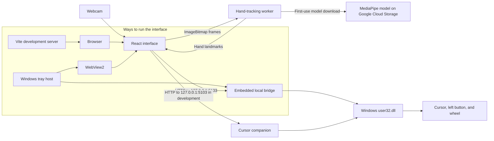

# Glimouse

**A touch-free way to point, click, and scroll.**

Glimouse turns a webcam view of your hand into mouse input on Windows. Hand tracking runs locally, and cursor movement and gestures stay disabled until you choose to enable them.

[](https://github.com/Itsahoora/Glimouse/actions/workflows/ci.yml)
[](https://github.com/Itsahoora/Glimouse/releases)
[](LICENSE)


[Download for Windows](#installation) · [How it works](#how-it-works) · [Development](#development)

## Overview

Glimouse combines a React interface, MediaPipe hand landmarks, and a small Windows companion to translate hand movement into mouse input. The app can show a live camera preview and hand overlay, while optional controls map your index finger to cursor movement, a pinch to left-click or drag, and an open palm to scrolling.

The Windows desktop app runs in the notification area when its window is closed. Glimouse is an experimental, locally processed alternative input method—not a cloud service or a replacement for every mouse action.

## Features

- **Live hand tracking:** Choose a camera, view its feed, and see detected hand landmarks overlaid on the preview.
- **Pointer control:** Enable index-finger cursor movement and adjust screen mapping, sensitivity, and smoothing.
- **Optional gestures:** Enable pinch-and-release for left-click, hold a pinch for dragging, or use an open palm to scroll.
- **Opt-in controls:** Movement, pinch actions, and scrolling are off by default.
- **Tray-based desktop app:** Closing the window hides Glimouse in the notification area; choose **Exit** from its tray menu to stop it.
- **Local settings:** Camera-independent preferences are saved in the app's local storage.

## Screenshots & demo

The repository does not currently include an authentic Glimouse interface screenshot or demo recording. A useful first addition would show the live camera preview with its landmark overlay alongside the movement, pinch, and scroll controls. A short real-use recording could demonstrate pointer movement and the optional gestures. No mockup is presented as a screenshot.

## How it works

The React frontend requests camera access and sends camera frames to a Web Worker. The worker runs MediaPipe Tasks Vision's hand landmarker and returns hand landmarks to the frontend. On first tracking initialization, MediaPipe downloads its hand-landmarker model from Google Cloud Storage; the frames and landmarks are otherwise processed locally by the app.

When enabled, the frontend sends cursor, left-button, and scroll commands over HTTP to `127.0.0.1:5103`. A C# bridge calls Windows `user32.dll` APIs to apply those commands. The desktop tray host embeds a bridge; browser-based development uses the separate cursor companion instead.



The tray host and cursor companion each bind to the same loopback port. Use the tray host for the desktop app, or run the companion for the Vite/browser workflow—not both at once.

## Technology stack

| Technology | Role |
| --- | --- |
| React and TypeScript | User interface, camera lifecycle, gesture controls, and cursor mapping |
| MediaPipe Tasks Vision | Hand landmark detection in a Web Worker |
| Vite | Frontend development server and production asset build |
| C# and .NET 10 | Windows tray host and local cursor companion |
| Windows Forms and WebView2 | Desktop window, notification-area menu, and embedded frontend |
| ASP.NET Core minimal APIs | Loopback HTTP endpoints for mouse commands |
| Vitest and Oxlint | Unit tests and frontend linting |

## Installation

### Download a Windows release

Glimouse currently publishes a Windows x64 ZIP. The [releases page](https://github.com/Itsahoora/Glimouse/releases) lists available versions; the current published asset is [Glimouse v0.1.0 for Windows x64](https://github.com/Itsahoora/Glimouse/releases/download/v0.1.0/Glimouse-v0.1.0-win-x64.zip).

1. Download the ZIP and extract the complete archive.
2. Run `Glimouse.exe` from the extracted folder. Keep the other files beside it.
3. Allow camera access if Windows asks.

The release is self-contained with the .NET runtime and app files. It still requires the **Microsoft Edge WebView2 Runtime** and a webcam. The first tracking session needs an internet connection to download the hand model.

The desktop app targets Windows x64. Closing its window leaves it running in the notification area; choose **Exit** from the tray icon menu to stop tracking and close the app.

## Development

### Prerequisites

- Windows x64 for the native desktop app and cursor bridge
- [Node.js 22 or later](https://nodejs.org/en/download) with npm
- [.NET 10 SDK](https://dotnet.microsoft.com/en-us/download/dotnet/10.0)
- [Microsoft Edge WebView2 Runtime](https://developer.microsoft.com/microsoft-edge/webview2/)
- A webcam and camera permission
- Internet access the first time hand tracking initializes, to download the model

### Run the desktop app

From the repository root:

```powershell
npm ci
npm run desktop
```

`npm run desktop` builds the frontend and starts the Windows tray host, which displays it in WebView2 and runs its local mouse bridge.

### Run the browser development version

In one terminal, install dependencies and start Vite:

```powershell
npm ci
npm run dev
```

Open the local URL printed by Vite. Camera preview and hand tracking run in the browser; cursor control also requires the companion. In a second terminal, start it from the repository root:

```powershell
dotnet run --project .\native\GestureMouse.CursorCompanion\GestureMouse.CursorCompanion.csproj
```

The companion is for browser development. Do not start it alongside the tray app, since both use `127.0.0.1:5103`.

### Check and build

These commands are defined by the project scripts and Windows workflows:

```powershell
npm ci
npm run lint
npm test
npm run build
dotnet build .\native\GestureMouse.CursorCompanion\GestureMouse.CursorCompanion.csproj
dotnet build .\native\GestureMouse.TrayHost\GestureMouse.TrayHost.csproj
dotnet run --project .\native\GestureMouse.CommandState.Tests\GestureMouse.CommandState.Tests.csproj --configuration Release
dotnet publish .\native\GestureMouse.TrayHost\GestureMouse.TrayHost.csproj -c Release -r win-x64 --self-contained false
```

GitHub Actions runs the frontend checks, builds the cursor companion, runs the native command-state scenarios, and publishes the tray app for pushes and pull requests to `main`.
```

To publish the self-contained Windows x64 app as in the release workflow, build the frontend first:

```powershell
dotnet publish .\native\GestureMouse.TrayHost\GestureMouse.TrayHost.csproj --configuration Release --runtime win-x64 --self-contained true
```

The publish output is written under `native\GestureMouse.TrayHost\bin\Release\net10.0-windows\win-x64\publish\`.

### Create a release

Pushing a version tag matching `v*` runs the release workflow. The latest published release remains `v0.1.0`; v0.1.1 is prepared but has not been published.

```powershell
$version = "vX.Y.Z"
git tag $version
git push origin $version
```

## Project structure

```text
.
├── src/
│   ├── App.tsx                         # UI, camera, tracking lifecycle, and controls
│   ├── workers/handTracking.worker.ts  # MediaPipe inference worker
│   └── lib/
│       ├── mouseMath.ts                # Gesture detection and cursor mapping/filtering
│       └── mouseMath.test.ts           # Gesture and cursor-mapping unit tests
├── native/
│   ├── GestureMouse.TrayHost/          # Windows Forms, WebView2, and embedded bridge
│   ├── GestureMouse.CursorCompanion/   # Standalone bridge for browser development
│   └── GestureMouse.CommandState.Tests/ # Native command-state regression tests
├── .github/workflows/
│   ├── ci.yml                          # Windows checks and publish artifact
│   └── release.yml                     # Tagged Windows release packaging
├── package.json                        # Frontend scripts and dependencies
├── CHANGELOG.md                        # Release notes
└── LICENSE                             # MIT License
```

## Privacy & security

- Camera frames are passed to the local hand-tracking worker; the checked-in app has no cloud backend or frame-upload path. The model itself is downloaded from Google Cloud Storage the first time tracking starts.
- The frontend and native bridge communicate over loopback HTTP at `127.0.0.1:5103`. The bridge binds to that address and applies host and CORS-origin checks; it is intended for local use, not as a network service. These checks are not a general security guarantee.
- The app stores preferences in browser/WebView local storage. No telemetry or account service is configured in the repository.
- Native mouse input is implemented with Windows `user32.dll` calls for cursor movement, the left button, and the wheel. The bridge releases a held left button when it stops.
- Movement, clicking/dragging, and scrolling are opt-in. The desktop app continues tracking while hidden in the notification area; choose **Exit** to stop it and release camera resources.

## Known limitations

- The native desktop app and cursor bridge are Windows-specific; the published release is x64 only.
- One hand is tracked at a time. Tracking quality depends on camera visibility, lighting, and the hand being in view.
- The model is not bundled, so first-time tracking requires an internet connection.
- Browser development needs the separate .NET companion for cursor control. Camera preview and hand tracking can run without it.
- Automated tests cover frontend gesture and mouse-safety logic, worker lifecycle, and native command-state scenarios; the repository does not include end-to-end camera or physical mouse-control tests.
- Glimouse exposes left-click, drag, and wheel scrolling; it does not implement right-click or arbitrary mouse buttons.

## Roadmap

| Version | Focus |
| --- | --- |
| v0.1.x | Bug fixes and stability |
| v0.2.0 | Improved gesture recognition |
| v0.3.0 | Better calibration and multi-monitor support |
| v0.4.0 | Customizable gestures |
| v0.5.0 | Performance improvements |
| v1.0.0 | Stable public release |

These are planned areas of focus, not features currently available in the app.

## Release notes

See [CHANGELOG.md](./CHANGELOG.md) for the v0.1.1 release notes.

## Contributing

Contributions and bug reports are welcome. There is not yet a separate contribution guide. For a larger change, consider opening an issue first to discuss the approach. A short change summary and the results of `npm run lint`, `npm test`, and `npm run build` help reviewers; native desktop changes should also be checked on Windows with a webcam.

## License

Glimouse is distributed under the [MIT License](LICENSE).

## Acknowledgements

- [MediaPipe](https://ai.google.dev/edge/mediapipe/solutions/vision/hand_landmarker) for hand landmark detection.
- [React](https://react.dev/), [Vite](https://vite.dev/), and [TypeScript](https://www.typescriptlang.org/) for the frontend stack.
- [Microsoft Edge WebView2](https://developer.microsoft.com/microsoft-edge/webview2/) and [.NET](https://dotnet.microsoft.com/) for the Windows desktop host and native bridge.
